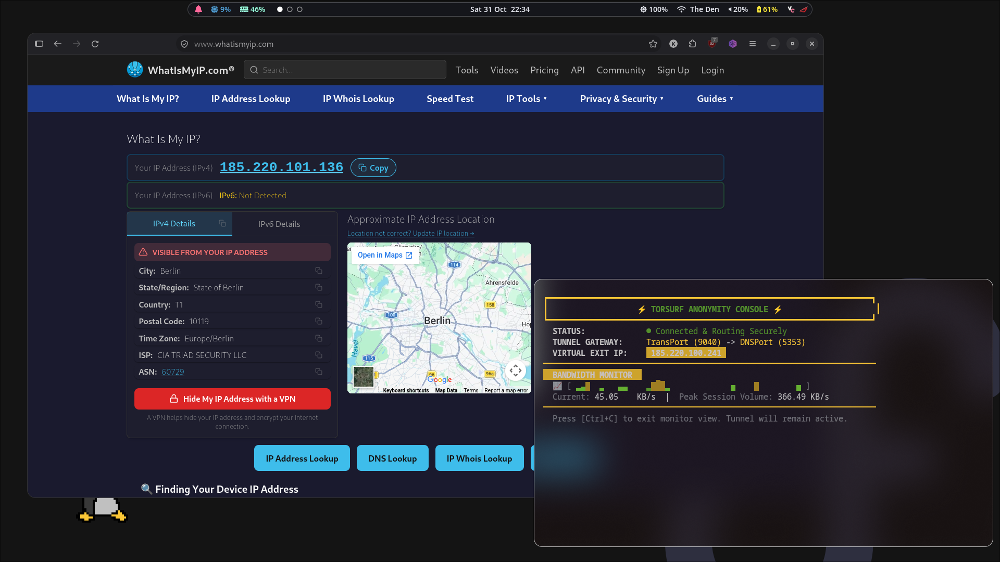

# TorSurf

> **Warning:** This project is solo maintained, so bug reports might be faced with some delay. Feel free to contribute!

TorSurf is a similar project to [Parrot Security's AnonSurf](https://github.com/ParrotSec/anonsurf). It routes all of your system's IPv4 TCP and DNS traffic through the [Tor](https://www.torproject.org/) network using transparent proxying and nftables firewall rules, and it includes a terminal dashboard to monitor the connection.



## Features

- **System-wide Tor routing:** TCP traffic is redirected to Tor's TransPort (`9040`), and DNS is redirected to Tor's DNSPort (`5353`).
- **Leak protection:** Raw UDP is dropped, and IPv6 output is blocked entirely to prevent dual-stack leaks.
- **Clean teardown:** The original nftables ruleset is backed up on start and restored on stop.
- **Live console:** Shows connection status, the Tor exit IP, and a bandwidth graph with current and peak speeds.

## Requirements

- Fedora (the installer checks for it and refuses to run on other distributions)
- Root access (`sudo`)
- Packages installed by `install.sh`: `tor`, `nftables`, `curl`, `jq`, `iproute`, `procps-ng`, `bind-utils`, `bc`

## Installation

```bash
git clone <repository-url> torsurf
cd torsurf
sudo ./install.sh
```

The installer does the following:

1. Installs the required packages with `dnf`.
2. Appends the TransPort, DNSPort, and virtual address settings to `/etc/tor/torrc` (only if they are not already present).
3. Copies `torsurf` and `torsurf-core` to `/usr/local/bin/`.
4. Enables the `tor` and `nftables` services.

## Usage

```bash
torsurf start    # Start Tor, apply firewall rules, and open the live console
torsurf stop     # Remove the firewall rules and stop Tor
torsurf status   # Show whether routing is ACTIVE or INACTIVE
```

`torsurf start` runs the backend with `sudo`, so you will be prompted for your password. It waits for Tor to bootstrap (up to 120 seconds) before applying the rules.

Press `Ctrl+C` to leave the console. **Leaving the console does not stop the tunnel.** Run `torsurf stop` to restore normal internet routing.

## How It Works

| Component | Role |
| --- | --- |
| `torsurf` | User-facing CLI. Runs the backend with `sudo`, displays the dashboard, and samples network throughput from `/proc/net/dev` once per second. |
| `utils/torsurf-core` | Root backend. Starts Tor as the `toranon` user, waits for bootstrap, loads the nftables rules, and restores the ruleset on stop. |
| `install.sh` | Installer. Installs packages, configures Tor, and copies the scripts to `/usr/local/bin/`. |

### Firewall rules

- **`nat_output` chain:** Keeps loopback and Tor's own (`toranon`) traffic out of the redirect. Redirects DNS to port 5353 and all other TCP to port 9040.
- **`filter_output` chain:** Allows loopback, Tor's traffic, established connections, redirected TCP, and DNS. Drops all other UDP.
- **`ip6` table:** Drops all IPv6 output except loopback.

### Exit IP

The exit IP shown in the console is fetched from `check.torproject.org` through the tunnel. If the lookup fails, the console shows `Protected / Fetching IP...` and retries.

## Files and Locations

| Path | Purpose |
| --- | --- |
| `/etc/tor/torrc` | Tor configuration (TorSurf settings are appended here) |
| `/usr/local/bin/torsurf` | CLI |
| `/usr/local/bin/torsurf-core` | Backend |
| `/tmp/torsurf_nft_backup.nft` | nftables backup, created on start and removed on stop |
| `/tmp/torsurf_tor.log` | Tor log, removed on stop |

## Known Limitations

- Only IPv4 TCP and DNS are routed. Other protocols and IPv6 are blocked or dropped, not tunneled.
- The `toranon` user is expected to exist. It is created by the Fedora `tor` package.
- The backend uses `/tmp` for its backup and log files.
- The console's "Connected" status and tunnel details are hard-coded text, not live checks.
- If the console exits unexpectedly, the tunnel stays up and must be stopped manually with `torsurf stop`.
- Only Fedora is supported.
- The installer and backend have not been tested on every system, and the installer is known to be broken.

## Troubleshooting

- **"Core initialization pipeline failed":** Read the backend output printed below the error. The Tor log is at `/tmp/torsurf_tor.log`.
- **"Tor handshake timed out":** Tor could not bootstrap within 120 seconds. Check your network connection or the Tor log.
- **Internet is broken after a failed start:** Run `sudo torsurf-core stop` (or `torsurf stop`) to restore the saved firewall ruleset.

## Credits

Inspired by [Parrot Security's AnonSurf](https://github.com/ParrotSec/anonsurf).

## Disclaimer

TorSurf is provided as-is with no guarantees. Routing through Tor does not make you anonymous by itself. Use it responsibly and follow the laws that apply to you.
